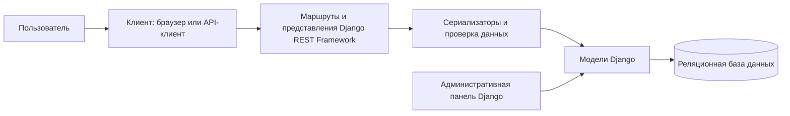

# Архитектура системы «Электронный журнал»

## 1. Общая схема

Система проектируется по клиент-серверной модели. Пользовательский клиент отправляет HTTP-запросы к серверу приложений. Сервер обрабатывает запрос, выполняет проверки, обращается к базе данных и возвращает ответ.

Схема показывает логическое разделение компонентов, а не отдельные физические серверы.

## 2. Компоненты

| Компонент | Ответственность |
|---|---|
| Клиент/API-клиент | Отправка запросов и отображение ответов |
| URL-маршрутизация | Направление запроса к нужному ресурсу |
| Представления API | Обработка операций чтения и изменения данных |
| Сериализаторы | Преобразование данных и проверка входных значений |
| Модели | Описание сущностей и связей |
| База данных | Долговременное хранение записей |
| Административная панель | Управление моделями уполномоченным администратором |

## 3. Основные сценарии

### Сценарий A. Просмотр студентов
1. Клиент отправляет запрос получения списка студентов.
2. API обращается к модели студентов.
3. Сериализатор формирует данные ответа.
4. Клиент получает список в JSON.

### Сценарий B. Добавление оценки
1. Клиент отправляет данные оценки.
2. API проверяет формат и обязательные поля.
3. Проверяются ссылки на студента и предмет.
4. Запись сохраняется в базе данных.
5. API возвращает результат операции.

### Сценарий C. Учёт посещаемости
1. Клиент передаёт студента, предмет, дату и статус.
2. API проверяет данные.
3. Запись сохраняется.
4. При последующем запросе запись должна возвращаться с теми же связями.

## 4. Безопасность

В целевой архитектуре следует предусмотреть:
- аутентификацию пользователей;
- разрешения по ролям;
- ограничение преподавателя назначенными группами и предметами;
- ограничение студента собственными данными;
- хранение секретов в переменных окружения;
- резервное копирование базы данных.

Эти меры требуют реализации и проверки. Нельзя считать ролевую модель действующей, если API не проверяет личность и права пользователя.

## 5. Развёртывание

Для локальной разработки можно использовать SQLite. Для целевого развёртывания может использоваться PostgreSQL, если он выбран и настроен в параметрах окружения. В обоих случаях необходимо выполнить миграции, проверить подключение и настроить резервное копирование.

## 6. Архитектурные ограничения

В текущем учебном проекте основные ресурсы API относятся к студентам, предметам, оценкам и посещаемости. Отдельный полноценный веб-интерфейс для каждой роли, отчётный модуль и ролевая авторизация должны рассматриваться как отдельные задачи, если их нет в фактическом коде.
