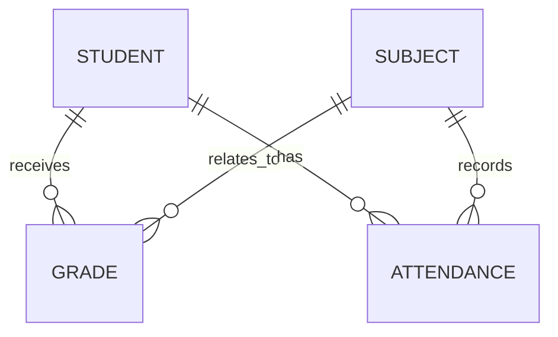

# Проектирование базы данных

## 1. Назначение

База данных хранит сведения об учебной группе и связанные с ними оценки и посещаемость. Ниже описана логическая модель. Перед изменением кода нужно сверить имена и точные типы полей с существующими моделями Django.

## 2. Основные сущности

### Student — студент
Предполагаемые атрибуты:
- идентификатор;
- имя и фамилия;
- группа/класс;
- контактные сведения, если они необходимы.

### Subject — предмет
Предполагаемые атрибуты:
- идентификатор;
- название предмета;
- имя преподавателя или ссылка на учетную запись преподавателя, если такая модель предусмотрена.

### Grade — оценка
Предполагаемые атрибуты:
- идентификатор;
- ссылка на студента;
- ссылка на предмет;
- значение оценки;
- дата;
- комментарий, если он предусмотрен моделью.

### Attendance — посещаемость
Предполагаемые атрибуты:
- идентификатор;
- ссылка на студента;
- ссылка на предмет;
- дата занятия;
- статус посещаемости.

## 3. Связи

- один студент может иметь много оценок;
- один предмет может встречаться во многих оценках;
- один студент может иметь много записей посещаемости;
- один предмет может иметь много записей посещаемости;
- каждая оценка и запись посещаемости относятся к одному студенту и одному предмету.

## 4. Целостность данных

Необходимо проверить:
- обязательность ссылок на студента и предмет;
- допустимые значения оценки;
- допустимые статусы посещаемости;
- корректность дат;
- поведение при удалении студента или предмета, если на них ссылаются оценки и посещаемость;
- отсутствие случайного создания записей с несуществующими внешними ключами.

Правила удаления следует выбирать осознанно: каскадное удаление может удалить связанные записи, а запрет удаления позволяет сохранить историю.

## 5. Индексы и ограничения

Для небольшой учебной базы достаточно стандартных индексов первичных и внешних ключей. При росте объёма данных можно рассмотреть индексы по дате и часто используемым связям. Уникальность записи посещаемости (например, студент + предмет + дата) можно вводить только после согласования того, допускается ли несколько занятий по одному предмету в день.

## 6. Миграции и резервное копирование

Изменения моделей следует проводить через миграции Django. Перед изменением структуры базы данных необходимо сделать резервную копию. Для эксплуатации нужно определить место хранения копий, периодичность и способ проверки восстановления.

## 7. Важное замечание

Этот документ является логической схемой проектирования. Точный перечень полей, названия таблиц и правила удаления определяются фактическими моделями приложения.
