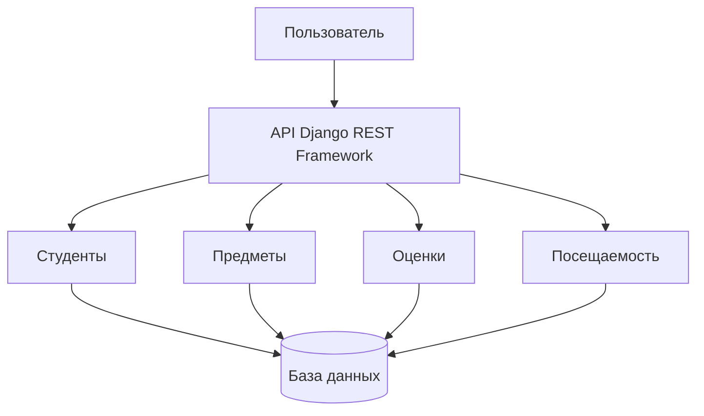

# МДК.04.02 — Проектирование программы

## Тема: Электронный журнал группы

В этой работе я описываю, как можно устроить электронный журнал для учёта студентов, предметов, оценок и посещаемости.

## 1. Цель проекта

Цель — хранить учебную информацию в одном месте и сделать её удобнее для просмотра и изменения.

## 2. Основные функции

В журнале должны быть:
- список студентов;
- список учебных предметов;
- оценки студентов;
- посещаемость занятий;
- возможность просматривать и менять записи через API;
- административная панель для управления данными.

Авторизацию по ролям, средний балл и подробные отчёты можно добавить позже. Это возможное развитие, а не уже готовая функция.

## 3. Какие технологии используются

- Python — язык программирования;
- Django — основа веб-приложения;
- Django REST Framework — для API;
- SQLite — база данных для локальной работы;
- PostgreSQL можно использовать при дальнейшей настройке;
- GitHub — для хранения кода.

## 4. Простая схема работы

Схема показывает, как части программы связаны между собой:

Пользователь обращается к API. API работает с данными студентов, предметов, оценок и посещаемости, а данные сохраняются в базе.

## 5. Данные журнала

В проекте есть четыре основные сущности:

| Название | Для чего нужна |
|---|---|
| Student | Хранит информацию о студенте |
| Subject | Хранит название предмета и преподавателя |
| Grade | Хранит оценку студента по предмету |
| Attendance | Хранит информацию о посещении занятия |

Оценка и посещаемость связаны со студентом и предметом. Благодаря этому можно понять, кому и по какому предмету поставлена оценка или отмечено посещение.

## 6. API

Для работы с данными предусмотрены адреса:

- `/api/students/` — студенты;
- `/api/subjects/` — предметы;
- `/api/grades/` — оценки;
- `/api/attendance/` — посещаемость.

Через API можно просматривать записи, а также выполнять доступные для ресурса действия. Например, GET используется для просмотра, POST — для добавления, PATCH или PUT — для изменения, DELETE — для удаления.

## 7. Как проверять программу

Во время проверки нужно посмотреть:
1. открывается ли список студентов;
2. добавляется ли новая запись;
3. отображаются ли предметы;
4. сохраняется ли оценка;
5. сохраняется ли посещаемость;
6. правильно ли меняются и удаляются записи.

Результаты проверок нужно записать после выполнения. Пока это список того, что следует проверить, а не отчёт об уже пройденных тестах.

## 8. Что можно улучшить

В будущем можно добавить вход в систему для разных пользователей, ограничить права преподавателей и студентов, сделать расчёт среднего балла и отчёты.

## Ссылка на код приложения

https://github.com/maramergesova14-cloud/elektronnyi-zhurnal
